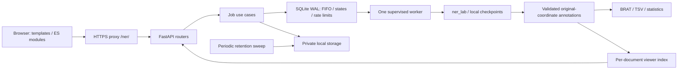

# Multilingual NER · TEMU / Barcelona Supercomputing Center

Explore, annotate and analyze multilingual documents. This account-free service
accepts UTF-8 TXT or nested-folder ZIP corpora, queues inference, and offers a
responsive, read-only annotation explorer plus BRAT/TSV exports. Results remain
private behind a capability link for **72 hours after completion**.

All NLP uses [ner_lab](https://github.com/nlp4bia-bsc/ner_lab), pinned to
`8640d4797b081a5f6b66d9b45c11269542a79a26`. No checkpoints are supplied or silently
downloaded. The example catalog deliberately disables inference until a trusted
administrator provisions and validates local models. Synthetic fixtures exist
only in tests; they do not represent biomedical model performance.

## Architecture



The existing single-host SQLite queue is preserved. Redis, RQ and PostgreSQL are
**not runtime dependencies** of this repository. They were an alternative in the
original brief, not services implemented by v1. SQLite transactions provide
persistent FIFO admission and atomic IP/email limits; a lifetime filesystem lock
allows one worker supervisor. Do not deploy this queue on NFS or across hosts.
A distributed queue migration is a separate project.

Before phase 2, main.py owned routes, validation, submission, status and middleware.
It now composes routers/services only. HTTP concerns live in app/api, use cases in
services/jobs.py, NLP orchestration in services/pipeline.py, and shared annotation
contracts in domain/annotations.py. Worker supervision remains separate from NLP.
Export writers and the viewer derive from the same validated original spans.
See [refactoring decisions](docs/REFACTORING_DECISIONS.md) for the complete inventory.

## Requirements

- Linux and Python 3.12 recommended (minimum 3.11; supervision uses Linux prctl/flock).
- A local private filesystem for SQLite WAL, input, results and temporary artifacts.
- Docker Engine with BuildKit and Docker Compose v2 for container deployment.
- For inference: the pinned NLP dependencies, complete trusted checkpoints and
  local tokenizers/backbone cache. GPU is optional; CPU is supported.
- Hardware depends on checkpoint sizes, batch size and corpus size. Compose's
  1 GiB web / 8 GiB worker limits are configurable examples, not measured minimums.
  No production capacity or GPU benchmark is claimed. Reserve disk for model
  weights, large NER dependency images, up to 72 hours of retained jobs and backups.

## Local installation and startup

```sh
git clone https://github.com/nlp4bia-bsc/ner-inference-web.git
cd ner-inference-web
git checkout work
python -m venv .venv
. .venv/bin/activate
pip install -r requirements.lock
pip install -e '.[test]'
cp .env.example .env
# Creates the database/tables and private rate-limit key idempotently:
python -c 'from app.config import Settings; from app.db import Database; Database(Settings())'
python -m pytest -q
uvicorn app.asgi:app --host 127.0.0.1 --port 8000 --no-access-log --no-proxy-headers
```

In another terminal with the same working directory/environment:

```sh
. .venv/bin/activate
python -m app.worker
```

Open http://localhost:8000. An idle worker and disabled model catalog are usable
without NLP packages. `/health` checks HTTP liveness; `/ready` checks database and
worker heartbeat and separately reports models_available. No SMTP is needed.
For actual inference install the revision-pinned dependency set:

```sh
pip install -r requirements-nlp.lock
```

requirements.lock pins HTTP dependencies; requirements-nlp.lock pins the complete
upstream NER extra and revision archive. Upstream also includes training/search
packages, making this image large. Local installation/test commands were exercised;
no clinical production checkpoint is part of this checkout.

## Configure and validate a model

Place a trusted checkpoint in a versioned directory, e.g. host
`models/es-disease-v1/` mounted at `/models/es-disease-v1` in Docker. It must contain
encoding.json, model.safetensors or pytorch_model.bin, and a saved fast tokenizer
(tokenizer.json and associated tokenizer config/vocabulary files). CRF checkpoints
may require the recorded backbone in the local Hugging Face cache as well.

Edit `catalog/models.yaml` (MODEL_CONFIG_PATH may point elsewhere):

```yaml
languages:
  es:
    display_name: Spanish
    statistics_model: null
    entities:
      DISEASE:
        display_name: Diseases
        description: Disease mentions
        model_id: es-disease-v1
        version: "1"
        model_dir: /models/es-disease-v1
        enabled: true
        min_score: 0.5
        batch_size: 16
```

This illustrates configuration, not an available/confirmed checkpoint. Locally use
its actual host path, not the Docker path. model ID/label must be safe identifiers.
Language and target label must match encoding.json exactly. statistics_model is an
optional local reference tokenizer; otherwise the first selected checkpoint is
used. Token counts from different models are never summed together.

```sh
python -m scripts.validate_models
# Restart API and worker together after successful preflight.
curl http://localhost:8000/api/models?language=es
```

Preflight runs offline, loads weights and reconstructs the saved ner_lab encoder.
It writes a validation receipt containing model IDs/checkpoint digests. Startup
and execution require a matching digest; queued jobs snapshot model identity and
options. Provision files readable by the runtime UID; catalog/receipts must only
be writable by administrators. Drain the queue before changing checkpoints.
The entity appears selectable after coordinated restart and a successful preflight.
The full process is covered by a synthetic tiny-BERT CPU integration test.

A real request after provisioning your authorized checkpoint/corpus:

```sh
curl -X POST http://localhost:8000/api/jobs \
  -F submitter_name=Researcher -F submitter_email=user@example.org \
  -F language=es -F entities=DISEASE -F 'files=@corpus.zip'
```

Save the returned private URL. No account/login or email verification is involved.

## Docker deployment

```sh
cp .env.example .env
docker compose build web
docker compose up -d
# After setting public origin / prefix, use these paths accordingly:
curl http://localhost:8000/health
curl http://localhost:8000/ready
docker compose logs --tail=100 web worker
docker compose restart web worker
docker compose stop
```

No database password/Redis secret is required: those services are not used. A
private rate-limit HMAC key is generated automatically in STORAGE_ROOT; capability
tokens use 256 random bits and only their hashes are persisted. Keep the named
`ner-data` volume private. Runtime UID is 10001; model and catalog mounts are
read-only, data is writable. Do not use `down -v` unless discarding retained jobs.

For a real NLP image after model/catalog preparation:

```sh
INSTALL_NLP=true docker compose build web
docker compose run --rm --user "$(id -u):$(id -g)" \
  -v "$PWD/catalog:/service/catalog:rw" worker python -m scripts.validate_models
docker compose up -d --force-recreate
```

Preflight must see the same `/models` paths and caches as the running worker.
The full GPU/training image dependency set was resolved, but its large NLP-enabled
Docker build was not executed. The no-NLP Docker image and web/worker Compose pair
have been built and run. See [deployment](docs/DEPLOYMENT.md) for optional build
CA secrets when using a managed HTTPS proxy and deployment-specific permissions.

## CPU and GPU

`DEVICE=auto` lets ner_lab choose CUDA when available; `DEVICE=cpu` forces CPU.
The upstream Torch version is 2.10.0. A CPU environment can first install that
version from https://download.pytorch.org/whl/cpu, then install the pinned NLP set.
Use a compatible wheel/driver/runtime for your infrastructure. To use GPU in
Docker, explicitly grant the worker a supported NVIDIA device/runtime and mount
any required local cache; setting DEVICE=cuda alone does not expose hardware.
GPU operation is **not tested in this environment**. Reduce registry batch_size
for memory pressure, restrict container resources and keep one inference worker.

## Production origin and `/ner/` reverse proxy

For the intended public deployment set both values in `.env`:

```dotenv
APP_PREFIX=/ner
PUBLIC_BASE_URL=https://temu.bsc.es/ner
JOB_RESULTS_TTL_HOURS=72
```

APP_PREFIX is an actual route prefix, not Uvicorn root_path. Preserve it upstream;
do not strip `/ner/`. API paths, redirects, static assets and private links all
include it. Example Nginx fragment inside the institution's TLS server:

```nginx
location = /ner { return 308 /ner/; }
location /ner/ {
    client_max_body_size 51m;
    proxy_pass http://127.0.0.1:8000;
    proxy_set_header Host $host;
    proxy_set_header X-Forwarded-For $remote_addr;
    proxy_set_header X-Forwarded-Proto https;
    proxy_read_timeout 300s;
    proxy_send_timeout 300s;
    proxy_buffering off;
    add_header Cache-Control "no-store" always;
    access_log off;
}
```

Terminate HTTPS with valid BSC certificates and configure HSTS at the institution's
proxy. Uvicorn's default --no-proxy-headers ignores spoofed forwarding headers.
Behind a trusted proxy it conservatively rate-limits the proxy IP. For per-client
IP limits, block direct backend access, overwrite forwarding headers at the proxy
and explicitly use --proxy-headers --forwarded-allow-ips=<trusted-proxy-IP/CIDR>.
Never trust `*` on a public backend. Disable capability URL logging in proxies/APM.

Check `/ner/health`, `/ner/ready` and `/ner/static/style.css` after deployment.
Prefix behavior is tested locally; **no BSC production deployment is claimed**.

## Explorer and result formats

Completed jobs offer **Explore annotations**, BRAT ZIP, TSV and JSON statistics.
The explorer uses the available horizontal space: three panels on desktop/tall
wide monitors, two at tablet widths and a stacked touch/keyboard workspace on
mobile. Documents are paged at 50, text at 5,000 code points and mention-list DOM
at 50. Search filenames, filter annotated documents/types/mention surfaces, find
text across the whole document and navigate documents, fragments and mentions.

Every crossing/nested/equal-boundary annotation remains selectable. A highlighted
atomic region shows its annotation count; selecting it reveals every covering
entity. Details show exact offsets, model and actual confidence. Emoji/combining
marks use code-point mapping, not naive JavaScript UTF-16 offsets. No HTML from a
document is interpreted and no content is sent to third-party services.
See [overlap rendering](docs/OVERLAP_RENDERING.md) and
[viewer architecture](docs/VISUALIZATION_ARCHITECTURE.md).

The archive retains original relative paths **including `.txt`** under
brat/documents/, matching ANN files, annotation.conf with unrestricted overlap
policy, annotations.tsv, document_statistics.tsv, statistics.json and manifest.json.
A document without entities has an empty ANN. TSV begins with filename, label,
start_span, end_span, text, then score/language/model/submitter metadata.

Illustrative stand-off annotation for `Cancer.` (not a clinical prediction):

```text
T1	DISEASE 0 6	Cancer
```

Actual ANN uses TAB separators between ID, span specification and surface.

## Retention, upgrade and maintenance

All originals, annotations, ZIP/TSV, statistics, viewer indexes and temporaries
expire 72 hours after terminal completion. Queue waiting time is excluded.
Every private route denies access exactly at expiry, independently of sweeping.
API/worker perform cleanup; run `python -m scripts.cleanup` under the same config
for a manual/scheduled sweep. PII is scrubbed; a minimal tombstone remains 24 hours.
No browser localStorage/IndexedDB or shared document cache is used.

For upgrades from v1, stop/drain the worker, back up configuration and a consistent
SQLite database only as allowed by retention policy, deploy API/worker together,
and optionally run `python -m scripts.migrate_retention` with the new TTL. It
extends only still-unexpired terminal jobs; expired links are never revived.
V1 completed result sets lazily build a private viewer index under a per-job lock.
No DB schema migration is required in this phase.

Model updates: use new immutable versioned paths, drain, preflight, restart, smoke
test with authorized nonsensitive text. ner_lab upgrades: change the pinned
revision and lock, review lower-level stats APIs, run the entire suite and real
checkpoint compatibility checks. Rebuild images and check /ready afterward.
Monitor worker heartbeat, queue states, failure types, disk space and cleanup.
Use SQLite's backup API (not an inconsistent copy of WAL files), encrypted private
volumes and backup lifetimes that do not preserve temporary documents indefinitely.

## Testing

```sh
python -m pytest -q                         # API, unit, pipeline, retention
python -m pytest -q tests/test_real_inference.py  # requires NLP deps; tiny random CPU model
python -m pytest -q tests/test_viewer_api.py # new contracts / prefix / controlled clock
python -m ruff check app scripts tests
python -m ruff format --check app scripts tests
pip install playwright
# Requires Chromium at /usr/bin/chromium; browser tests start a temporary prefixed server.
BROWSER_TESTS=1 python -m pytest -q
# Viewer-specific tests start their own temporary prefixed server:
BROWSER_TESTS=1 python -m pytest -q tests/test_viewer_browser.py
```

Viewer browser cases cover widths 320, 375, 390, 768, 1024, 1440, 1920 and 2560,
actual DOM selection of every overlap, original Unicode text, filters, search,
empty documents, download access and no horizontal layout overflow. Optional
SCREENSHOT_OUTPUT points to a writable directory for 390/1440px screenshots.
See [verification](docs/VERIFICATION.md) for actual results and untested limits.

## Troubleshooting

| Symptom | Checks / action |
|---|---|
| Worker inactive / queue blocked | /ready, worker logs, matching data/config paths; do not remove a live worker lock or add parallel workers. Restart supervisor for controlled interrupted-job replay (maximum two attempts). |
| PostgreSQL/Redis unavailable | Neither is used here. Remove stale external service assumptions; inspect SQLite/data volume instead. |
| No model enabled / invalid checkpoint | Inspect /api/models, local permissions, encoding language/target, tokenizer.json and validation receipt. Run offline preflight in the actual runtime. |
| Tokenization error | Provision the saved fast tokenizer/backbone cache; confirm encoding.json compatibility. Do not replace the model's windows with arbitrary truncation. |
| Memory/CUDA failure | Lower batch size, use DEVICE=cpu to diagnose, verify Torch/driver/device grant, review resource limits. No success/partial download is published for failed jobs. |
| Invalid ZIP | UTF-8 TXT only, no empty documents, links, duplicate/unsafe paths or nested ZIPs; respect byte/entry/compression/document bounds. |
| Expired results | HTTP 410 means expired, 404 means unknown/deleted tombstone; resubmit authorized originals. |
| Cleanup failed | Check filesystem permissions/free space, logs and `python -m scripts.cleanup`; schedule cleanup if both web/worker are stopped. |
| Proxy / static 404 / bad form origin | APP_PREFIX and PUBLIC_BASE_URL must agree; preserve /ner upstream and use its exact public origin. Check prefixed /health and static paths. |
| Viewer error | Check job completion/expiry, private index permissions, browser network/console, CSP and original span validation. Never log/share capability URLs or clinical text. |
| Storage full / service busy | Admission reserves worst-case active/queued jobs plus actual retained terminal bytes; check MAX_STORAGE_MB, free floor and retention. Use a real filesystem quota for a hard limit. |

## Security, layout and limits

No accounts or verified identity: anyone with a capability link can access its
results while valid. Keep TLS, trusted proxy boundaries, private storage, rate
limits, upload bounds and no-store/no-referrer/noindex/CSP. Administrators must
approve the institution's data-handling/retention policy and trusted checkpoints.
The service does not anonymize documents. See [security](docs/SECURITY.md).

```text
app/main.py              composition root
app/api/                 routers, HTTP middleware/errors and schemas
app/domain/              original-coordinate annotation contracts
app/services/jobs.py     admission/status/result use cases
app/services/pipeline.py ner_lab/statistics/export/index orchestration
app/services/exports/    BRAT and TSV writers
app/visualization/       typed contracts and private document repository
app/worker.py            sequential process supervision
app/db.py, storage.py    persistence / private local storage
app/templates/, static/  responsive UI and dependency-free ES modules
catalog/                 declarative models and local validation receipt
scripts/                 preflight, cleanup and explicit retention upgrade
tests/, docs/            unit/API/integration/browser checks and operating guides
```

Real BSC checkpoints/corpora, clinical accuracy, GPU performance, maximum-density
soak tests, domain/TLS/proxy deployment and institutional backup approval remain
pending. No precision/recall/F1 is shown without gold. Dense annotations may
require many pages; server fragment reads still decode one bounded full document.
This is a read-only explorer, not an editor. No distributed queue, S3 backend,
automatic language detection or notification service is implemented.

Visual evidence: [desktop and mobile captures](docs/PREVIEWS.md), using clearly
identified synthetic test fixtures rather than real biomedical model results.
