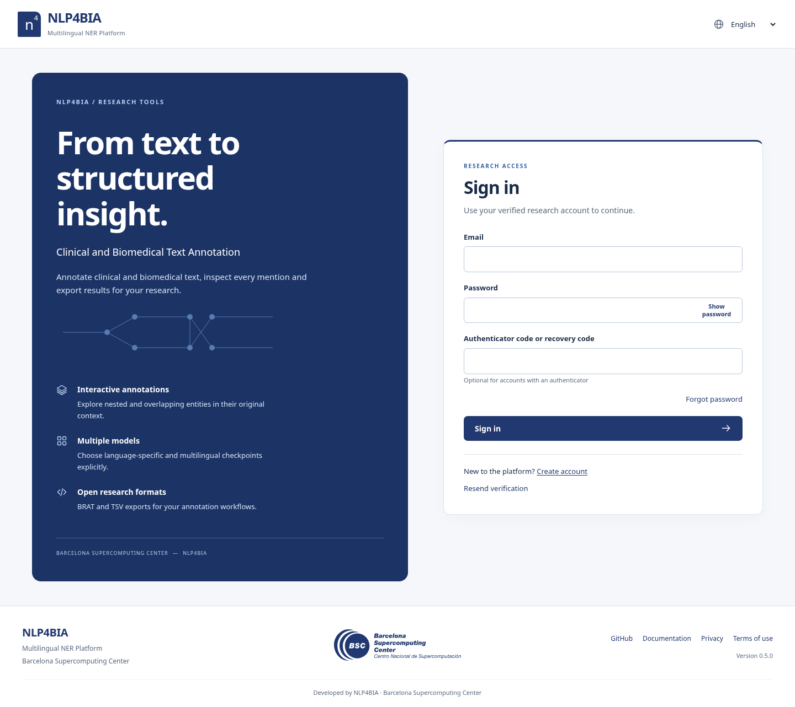
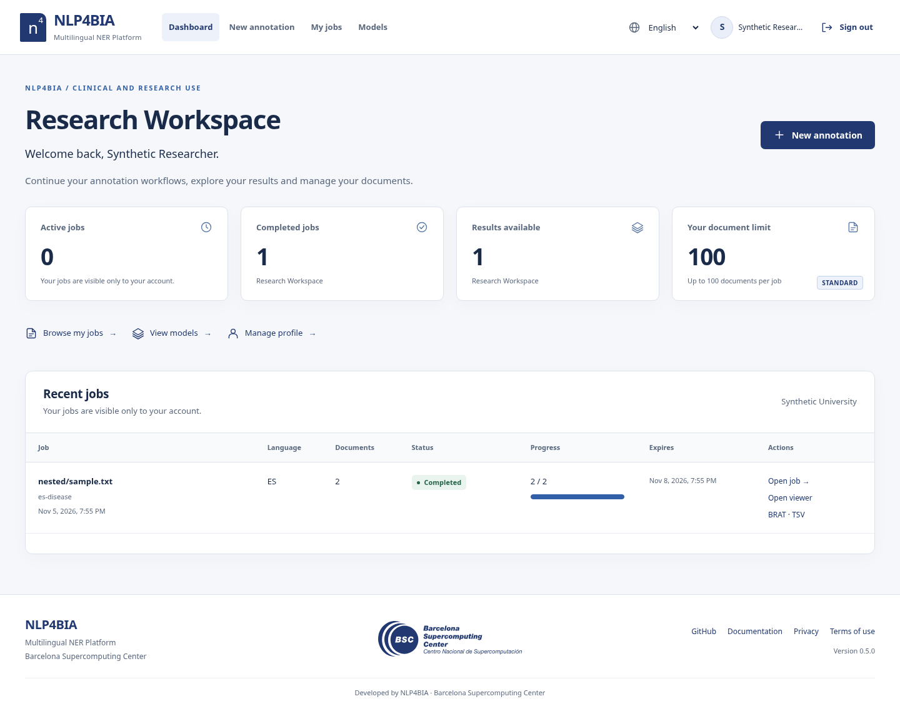
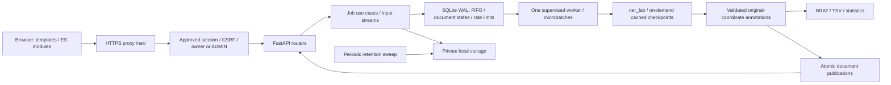

# NLP4BIA · Multilingual NER Platform

**Clinical and Biomedical Text Annotation**

Developed by NLP4BIA · Barcelona Supercomputing Center

Explore, annotate and analyze multilingual documents with registered accounts.
Pasted text, UTF-8 TXT and nested-folder ZIP corpora use incremental ner_lab
inference, an overlap-preserving explorer and BRAT/TSV exports. Every work route
requires an approved account. Owners and authorized administrators can
access projects; a private link alone grants no access. Files remain available
for **72 hours after completion**.

Version **0.12.1** keeps users and projects together in **Administration** (`/admin`),
with users above the project explorer and no secondary global administrator bar.
Dense entity towers now wrap against the full label/text geometry, retaining
centered labels, continued shared overlap brackets and the existing entity colors
without horizontal clipping on mobile.

Version **0.12.0** adds the lazy administrator tree: users → projects → documents
→ annotations, with real aggregate statistics, existing viewer/export links and
confirmed foreign-document erasure. See [explorer definitions](docs/ADMIN_EXPLORER.md).
Production on **bscdspace** uses the existing Apache proxy at
**https://temu.bsc.es/annotation-tool/** through `docker-compose.apache.yml`.
The persistent volumes remain unchanged and the CPU lock pins NumPy2.3.5.
See the [Apache deployment quickstart](docs/DOCKER_QUICKSTART.md).

Version **0.11.1** disables MFA by default, including for previously enrolled
accounts. Administrators sign in with email/password and can use all administrative
features immediately. OTP inputs, MFA links and enrollment endpoints are unavailable.
Account approval, role checks, CSRF and session revocation remain mandatory.
No new configuration is required; `ENABLE_MFA=true` is a future explicit opt-in.

Version **0.11.0** adds mandatory administrator approval for new access requests,
account deletion and an **All projects** administration view. Administrators can
inspect/delete any project and set a numeric document quota for each user. Existing
accounts, administrator credentials and MFA remain valid through automatic migration.
An administrator workspace uses a pale mauve theme across every page while retaining
the NER category palette. See [administration and approval](docs/ADMINISTRATION.md).

Version 0.10.6 restores the requested color families consistently in labels and
shared brackets: light pink for DISEASE, orange for SYMPTOM, blue for PROCEDURE
and green for MEDICATION. Secondary categories use more separated colors.
Caption text switches to dark ink on light fills to preserve readability.

Version 0.10.5 draws one shared bracket immediately above each connected annotated
region. Its thin stroke alternates category colors only over actual overlaps;
separate regions keep separate brackets. There are no source bands or brackets
attached to individual labels. Towers retain centered labels and original offsets.

Version 0.10.3 adds editable job names above the document inputs, autofilled from
the TXT/ZIP filename without its extension while preserving existing text.
**Other (OTH)** records a specified document language and enables selection of
registered multilingual models; the language description is not used for inference yet.
All tower labels retain solid category colors before and after selection.

Version 0.10.2 uses **Fuzzy match** in the interface and fixes inspector field
spacing across languages and screen sizes. See the [Docker quickstart](docs/DOCKER_QUICKSTART.md)
for a complete web/worker deployment, private terminology import and optional NVIDIA GPU overlay.

Version 0.10.1 fixes unfinished-job access to the actual HTML viewer and makes
tower height depend solely on simultaneous annotation overlap. Disjoint labels
share one level; wide captions receive horizontal spacing.

Version 0.10 makes originals readable from admission, publishes NER results after
each model batch and normalization after each category batch, and preserves
partial snapshots on interruption. The viewer updates without reloading. See
[phases, live results and recovery](docs/INCREMENTAL_PROCESSING.md).

Version 0.9 defaults to direct-Parquet exact/Levenshtein normalization (adjustable
0.8 threshold), with a separate slower bi-encoder opt-in. It fixes DT4H language
grouping using `cs/en/es/it/nl/ro/sv` directories; **reimport the ZIP** to replace
mixed resources. See [Conda update and reimport](docs/NORMALIZATION.md#fast-parquet-matching-and-corrected-language-grouping-09).

Version 0.8.2 accepts mixed ISO/UMLS language metadata and checks every archive
file before preparing terminology.

Version 0.8.1 adds selected-document deletion and imports DT4H list-valued
terminology, preserving medication UMLS/source identifiers. See
[private import instructions](docs/NORMALIZATION.md#importing-the-dt4h-zip-after-updating-to-081).

Version 0.8 adds live per-model/window progress, explicit worker availability and
FAISS/index phases, Dashboard project deletion and bulk deletion in My documents.
Compose starts with loopback HTTP defaults without shell exports. Native Conda
continues to use two Python processes and a shared private `.env`; see
[configuration and queue diagnostics](docs/DEPLOYMENT.md#08-persistent-local-configuration-and-queue-diagnostics).

Version 0.7 added **occupied / limit** quotas across all retained jobs, immediate
owner-controlled document erasure, and a permanent private upload-metadata history.
The interface supports the 15 MultiClinSum-2 languages plus Estonian, with larger
fonts at 1440p and 4K. A red upload notice states the user's de-identification
responsibility. Explicit bi-encoder normalization uses native ner_lab bi-encoders,
FlatIP and length 256, with a three-language/72-hour private index cache.

**Confidential gazetteers belong in `gazetteers/` inside the repository root.**
The directory is ignored by Git and excluded from images/packages. See
[private import and normalization](docs/NORMALIZATION.md) and
[Conda upgrade instructions](docs/DEPLOYMENT.md#updating-to-07-in-conda).


Accounts use a **four-character minimum password**. Registration checks that the
normalized email is unique and creates a **pending access request**. An administrator
must approve it before sign-in or job submission. Email verification is disabled by
default and is independent from administrator approval. SMTP is optional for registration. Account help/error reports
link to **fernando.gallego@bsc.es** through the user's mail client.

V4 introduced optional email verification, Argon2id, server sessions/CSRF, personal dashboards,
account-derived 100 / 1000 / UNLIMITED tiers and audited administration with TOTP.
V5 adds the shared institutional interface, research workspace, responsive catalog/
annotation viewer and complete EN/ES/CA controls. Scientific offsets and consolidation
remain unchanged. Session, CSRF and backend authorization checks remain mandatory.
Since0.5.4, `REQUIRE_EMAIL_VERIFICATION=false` is the default; older verification
instructions apply only when that legacy policy is explicitly enabled.
See [authentication and operations](docs/AUTHENTICATION_V4.md),
[security audit](docs/SECURITY_AUDIT_V4.md),
[independent review](docs/SECURITY_REVIEW_V4.md) and
[every protected route](docs/ROUTE_SECURITY_V4.md).

CPU and GPU inference profiles have separate dependency locks. Current validation
and dependency-audit results, including their limits, are recorded in
[verification](docs/VERIFICATION.md).

Inference uses [ner_lab](https://github.com/nlp4bia-bsc/ner_lab), pinned to
`8640d4797b081a5f6b66d9b45c11269542a79a26`, for windows, original-coordinate
decoding and statistics, with Transformers for standard Hub token classifiers.
Configured repositories are selectable immediately. **Models download
on their first job and persist in the shared Hugging Face cache**; being enabled,
preloaded or prevalidated is not a prerequisite. Image builds install runtime
libraries, never checkpoint weights. Failed models are logged and omitted while
valid models continue; mixed outcomes produce explicit partial results.
See [on-demand loading and cache operations](docs/ON_DEMAND_MODELS.md).
Synthetic fixtures are not evidence of biomedical model accuracy.


## Research interface

The public welcome is the protected platform's Sign in screen. After actual email
login, Research Workspace shows only your retained job metrics/history,
with New annotation, My jobs, Models and Profile navigation. The model catalog is
also private. Administration requires an approved active ADMIN. Its
Projects section below User management grants authorized inspection and erasure across owners.





New annotation separates input, document language, explicit entity/model choices
and review/admission. TXT, nested-folder ZIP and pasted text retain their existing
backend behavior. The wide viewer preserves overlaps, original Unicode offsets,
model provenance, keyboard selection, partial results and BRAT/TSV/TXT/ANN exports.
Progress and72h expiry always use actual server state. Phones use a compact menu,
stacked panels, job cards and a native entity-details sheet. The UI language selector
retains input files/text, chosen checkpoints, document language and result filters.

Screenshots use explicitly synthetic accounts and controlled annotations, including
adversarial Unicode/overlap/XSS strings. They are not predictions from clinical
checkpoints. See the [complete gallery and verification](docs/REDESIGN_VERIFICATION.md).

The frontend remains FastAPI/Jinja/ES modules, without a framework migration or
production UI library. `base.html` and `components.html` share the shell/footer;
`auth.css` owns reusable tokens/components; `style.css` owns scientific workspace
layouts. System fonts and all runtime assets load locally. The supplied original
[BSC SVG](app/static/assets/bsc-blue.svg) is preserved byte-for-byte, audited for
active/external content and rendered proportionally with alternative text.

The profile includes allowed edits, saved language, verification/tier/limit,
password/MFA, active-session metadata and logout-all. Account deletion requests
are audited for institutional review; they are not immediate deletion. Privacy
and terms links point to explicit drafts requiring institutional review.

[Design system](docs/DESIGN_SYSTEM.md) · [User experience](docs/USER_EXPERIENCE.md) ·
[Privacy draft](docs/PRIVACY_NOTICE.md) · [Terms draft](docs/TERMS_OF_USE.md).

To update translations and run the actual browser/accessibility matrix:

```sh
python -m scripts.build_ui_translations
npm install --prefix work/design-a11y --no-audit --no-fund axe-core@4.14.0
AXE_CORE_PATH=work/design-a11y/node_modules/axe-core/axe.min.js \
SCREENSHOT_OUTPUT=work/design-screens BROWSER_TESTS=1 python -m pytest -q
```

Playwright and a local Chromium installation are test tools, not runtime frontend
dependencies. CI installs its browser and gates the visual/auth/security checks.
Automatic accessibility checks plus keyboard/reflow probes are not WCAG certification.

## Architecture



V3 publishes each document as soon as **all selected models** finish and offsets
validate. A persistent top progress bar shows actual annotated/processing/pending/
failed counts and can be collapsed without losing state. You can explore finished
documents while the rest of the job runs. Accepted/completed dialogs and a
server-synchronized countdown make job lifecycle events explicit.

The existing single-host SQLite queue is preserved. Redis, RQ and PostgreSQL are
**not runtime dependencies** of this repository. They were an alternative in the
original brief, not services implemented by v1. SQLite transactions provide
persistent FIFO admission and atomic IP/email limits; a lifetime filesystem lock
allows one worker supervisor. Do not deploy this queue on NFS or across hosts.
A distributed queue migration is a separate project.

Before phase 2, main.py owned routes, validation, submission, status and middleware.
It now composes routers/services only. HTTP concerns live in app/api, use cases in
services/jobs.py, NLP orchestration in services/pipeline.py, and shared annotation
contracts in domain/annotations.py. Worker supervision remains separate from NLP.
Export writers and the viewer derive from the same validated original spans.
See [refactoring decisions](docs/REFACTORING_DECISIONS.md) for the complete inventory.

## Requirements

- Linux and Python 3.12 recommended (minimum 3.11; supervision uses Linux prctl/flock).
- A local private filesystem for SQLite WAL, input, results and temporary artifacts.
- Docker Engine with BuildKit and Docker Compose v2 for container deployment.
- For inference: the pinned NLP dependencies and outbound Hugging Face access
  for the first download, or complete cached/local checkpoints. GPU is optional;
  CPU is supported.
- Hardware depends on checkpoint sizes, batch size and corpus size. Compose's
  1 GiB web / 8 GiB worker limits are configurable examples, not measured minimums.
  No production capacity or GPU benchmark is claimed. Reserve disk for model
  weights, large NER dependency images, up to 72 hours of retained jobs and backups.

## Local installation and startup

```sh
git clone https://github.com/nlp4bia-bsc/ner-inference-web.git
cd ner-inference-web
git checkout work
python -m venv .venv
. .venv/bin/activate
# CPU inference libraries, including HTTP dependencies; no model weights:
python -m pip install -r requirements-cpu.lock
python -m pip install -e '.[test]'
cp .env.example .env
python -m scripts.check_config --expect-origin http://127.0.0.1:8000
python -m uvicorn app.asgi:app --host 127.0.0.1 --port 8000 --no-access-log --no-proxy-headers
```

In another terminal with the same working directory/environment:

```sh
. .venv/bin/activate
python -m scripts.check_config --expect-origin http://127.0.0.1:8000
python -m app.worker
```

Startup creates the database/tables and private key idempotently. Running pytest
is an optional development check, not a startup/migration step. On later updates,
keep your private `.env`, review changed examples and restart both processes.

Exported shell variables override `.env`; copying the file cannot replace an old
export. The diagnostic above prints the effective safe settings, their sources,
the file/application/interpreter paths and whether inference libraries are
installed. It never prints credentials. `origin_matches` must be true, and
`REQUIRE_EMAIL_VERIFICATION` must be false for the default no-verification policy.
See [remote native startup and stale exports](docs/DEPLOYMENT.md#native-python-and-remote-port-forwarding)
for exact recovery commands on the machine that actually runs the services.

Open http://127.0.0.1:8000 after copying the local-development .env example.
Local development accepts both `localhost` and `127.0.0.1` on the configured
scheme and port. Their cookies remain separate, so sign in on each hostname;
private job links preserve the browser's hostname. This alias pair applies only
to development/test with local cookies. Production requires its configured origin.
`0.0.0.0` is a listen address, not a wildcard browser origin or a CSRF setting.
Anonymous access redirects to login. Register with a unique email and a password
of at least four characters, then sign in; the dashboard shows the STANDARD
100-document tier. No verification email is required by default. Use /annotate for
a new job. Account/session flows work without NLP packages; inference downloads
the selected configured checkpoints on first use and caches them persistently.
/health and /ready expose only minimal status. Production requires HTTPS/Secure
cookies. SMTP is optional unless email verification or password recovery is
enabled; local capture mail is rejected in production.
The CPU setup above installs the revision-pinned inference libraries.
requirements.lock alone pins HTTP dependencies; requirements-cpu.lock pins the CPU NER
profile and requirements-nlp.lock the CUDA NER profile, both with the exact upstream
revision archive. Upstream also includes training/search
packages, making this image large. Local installation/test commands were exercised;
no clinical production checkpoint is part of this checkout.

The worker checks inference modules at startup, without loading model weights.
Missing modules produce a clear installation message and stop the worker before
claiming jobs. Install the chosen profile using the same interpreter that runs
the worker (for example `python3 -m pip install -r requirements-cpu.lock` when
`python3` is the working Conda executable). Resubmit previously failed jobs after
fixing the runtime; they are not silently rerun or rewritten.

## Account and administrator setup

V4 delivery: [implementation, acceptance results and remaining limits](docs/DELIVERY_V4.md).

The .env example is **local development only**: loopback HTTP, local cookies and
`MAIL_BACKEND=none`. For production set APP_ENV=production, COOKIE_SECURE=true,
PUBLIC_BASE_URL=https://temu.bsc.es/ner and APP_PREFIX=/ner. Verification stays off
unless explicitly enabled. SMTP is optional for recovery or email integrations;
when used, configure authorized SMTP_HOST/PORT/USERNAME/PASSWORD/FROM with STARTTLS
and certificate verification. Keep .env/credentials private and untracked.

```sh
python -m scripts.create_admin
# In Docker, use the configured web container and an interactive terminal:
docker compose exec web python -m scripts.create_admin
```

The command prompts securely; no default/password argument/first-registrant rule
exists. Keep the existing administrator on upgrades; bootstrap only once. Sign in,
then open /admin. MFA is disabled by default, including for existing enrolled
accounts. No authenticator enrollment or code is needed. An administrator can search
access requests and profiles, approve/decline, assign tiers/roles/numeric quotas,
suspend/reactivate, revoke sessions and delete accounts. Projects, below users on the same page, allows
inspection and erasure of other owners' documents. Email verification applies
only when explicitly enabled. See [administration](docs/ADMINISTRATION.md).

STANDARD=100 documents, EXTENDED=1000, UNLIMITED=null administrative cap. Tier
and numeric quota changes are checked fresh at admission; every batch is counted
and validated in full, including ZIP folders. UNLIMITED retains byte/expansion/ZIP-entry/storage/queue/time/resource
bounds. MAX_DOCUMENTS_PER_JOB is an optional technical ceiling, unset by default;
remove an old global1000 setting if it should not constrain UNLIMITED.

Sessions default to12h absolute/30min idle. Logout, logout-all, suspension and
password changes revoke server records. Automatic polling does not renew idle;
actual browser interaction does. CSRF is required for every write, including login.
Production host-prefixed cookies use Path=/ even under /ner, with a distinct name
for the prefix. The UI keeps English by default and translates auth/profile flows
into Spanish/Catalan. See [full configuration and workflows](docs/AUTHENTICATION_V4.md)
and [account/deployment recovery](docs/RECOVERY_V4.md).

Upgrade with both web/worker drained/stopped and a consistent protected SQLite/key
backup. Startup applies additive migrations through6; it does not reset FIFO, rewrite
clinical artifacts or extend deadlines. Old ownerless jobs remain closed to
ordinary users and are never claimed by matching email; administrators may inspect
or erase them. Never roll back to anonymous v3 while exposing an owned database.

## Model catalog correction

The registry now includes all 36 repository links from the supplied Excel and the
exact GreekMedNLP 2025–2026 checkpoint, preserving existing IDs. Categories are
peers; sublabels stay inside their main category. Users explicitly select one or
more checkpoints per category, with a separate Multilingual models section.
Opening a category selects nothing. Same-category/same-offset predictions display
once and retain every source model, original label and individual score.

In the default on-demand mode all 48 configured repository entries can be
selected without activation or an offline receipt. Entries without a
repository/local source remain visible but unavailable. Native/custom/dependent
formats that cannot load fail individually at runtime and are logged; their
failure never fabricates annotations or removes other models' valid predictions.
The spreadsheet's metrics are reported evidence, not independently reproduced F1.
See [catalog operations and evidence](docs/MODEL_REGISTRY.md) and
[inventory provenance](catalog/inventory-provenance.json).

## Optional legacy mode: configure and validate a local model

This section applies only to `MODEL_LOADING_MODE=validated_local`. It is not
required for the default `MODEL_LOADING_MODE=on_demand` workflow.

Place a trusted checkpoint in a versioned directory, e.g. host
`models/es-disease-v1/` mounted at `/models/es-disease-v1` in Docker. It must contain
encoding.json, model.safetensors or pytorch_model.bin, and a saved fast tokenizer
(tokenizer.json and associated tokenizer config/vocabulary files). CRF checkpoints
may require the recorded backbone in the local Hugging Face cache as well.

Edit `catalog/models.yaml` (MODEL_CONFIG_PATH may point elsewhere):

```yaml
languages:
  es:
    display_name: Spanish
    statistics_model: null
    entities:
      DISEASE:
        display_name: Diseases
        description: Disease mentions
        model_id: es-disease-v1
        version: "1"
        model_dir: /models/es-disease-v1
        enabled: true
        min_score: 0.5
        batch_size: 16
```

This illustrates configuration, not an available/confirmed checkpoint. Locally use
its actual host path, not the Docker path. model ID/label must be safe identifiers.
Language and target label must match encoding.json exactly. statistics_model is an
optional local reference tokenizer; otherwise the first selected checkpoint is
used. Token counts from different models are never summed together.

```sh
python -m scripts.validate_models
# Restart API and worker together after successful preflight.
curl http://127.0.0.1:8000/api/models?language=es
```

Preflight runs offline, loads weights and reconstructs the saved ner_lab encoder.
It writes a validation receipt containing model IDs/checkpoint digests. Startup
and execution require a matching digest; queued jobs snapshot model identity and
options. Provision files readable by the runtime UID; catalog/receipts must only
be writable by administrators. Drain the queue before changing checkpoints.
The entity appears selectable after coordinated restart and a successful preflight.
The full process is covered by a synthetic tiny-BERT CPU integration test.

An authenticated request after provisioning a checkpoint and obtaining a session
cookie file and CSRF proof through the documented login workflow (do not put a
password in shell arguments):

```sh
curl -X POST http://127.0.0.1:8000/api/jobs \
  --cookie /private/session-cookies --header 'X-CSRF-Token: <session-csrf-proof>' \
  -F language=es -F entities=DISEASE -F 'files=@corpus.zip'
```

Save the returned locator URL. It remains protected by approved login, owner or ADMIN authorization and
expiry; sharing a token does not transfer access. Name/email come from the account.
See docs/API.md for repeated checkpoint IDs and all authentication contracts.

## Docker deployment

```sh
cp .env.example .env
docker compose build web worker
docker compose up -d
# After setting public origin / prefix, use these paths accordingly:
curl http://127.0.0.1:8000/health
curl http://127.0.0.1:8000/ready
docker compose logs --tail=100 web worker
docker compose restart web worker
docker compose stop
```

The example is local development at `http://127.0.0.1:8000`, with
`APP_ENV=development`, `COOKIE_SECURE=false` and no email dependency. Production
requires `APP_ENV=production`, `COOKIE_SECURE=true` and the actual HTTPS
`PUBLIC_BASE_URL`. Copy the example before starting Compose; recreating both
services applies changed environment values (`docker compose up -d --force-recreate`).
Restart alone does not update container environment. A cookie-policy change
requires signing in again; the existing accounts/documents remain in the volume.

No database password/Redis secret is required: those services are not used. A
private HMAC/encryption root key is generated automatically in STORAGE_ROOT.
Session/action/job identifiers use 256 random bits with only verifiers persisted.
Protect both database and key backups; account secrets/outbox data are encrypted. Keep the named
`ner-data` volume private. Runtime UID is 10001; model and catalog mounts are
read-only, data is writable. Do not use `down -v` unless discarding retained jobs.

For the default on-demand CPU worker (no model preparation step):

```sh
docker compose build web worker
docker compose up -d --force-recreate
```

Web and worker have separate images. The worker installs the pinned CPU libraries
by default; GPU is an explicit deployment option. The model cache lives under
`/data/model-cache` in the persistent `ner-data` volume and survives job expiry
and service restarts. The CPU worker image has been built. See [deployment](docs/DEPLOYMENT.md) for optional build
CA secrets when using a managed HTTPS proxy and deployment-specific permissions.

## CPU and GPU

`DEVICE=auto` lets ner_lab choose CUDA when available; `DEVICE=cpu` forces CPU.
The upstream Torch version is 2.10.0. requirements-cpu.lock selects the CPU wheel
and excludes CUDA runtime packages; requirements-nlp.lock is the original GPU
profile. Use NLP_PROFILE=cpu or gpu with INSTALL_NLP=true when building Docker.
Setting DEVICE=cpu on an already CUDA-built image does not remove its GPU packages.
To use GPU in Docker, explicitly grant the worker a supported NVIDIA device/runtime
and mount any required local cache; DEVICE=cuda alone does not expose hardware.
GPU operation and full NLP Docker image builds are **not tested here**. Native CPU
inference and session equivalence have been executed in the development environment.

Set INFERENCE_DOCUMENT_BATCH_SIZE (default 32) to bound source-document memory,
independently of each model's window batch_size. MAX_LOADED_MODELS (default 2)
bounds a job-scoped versioned LRU cache. Tune both with measured RAM/VRAM: larger
model sets may still require checkpoint reloads. Scientific encoding/windows are
unchanged; the child/cache is released at job completion. See
[session/publication design](docs/INCREMENTAL_PROCESSING.md) and
[measured synthetic benchmarks](docs/PERFORMANCE_V3.md).

## Production origin and `/ner/` reverse proxy

For the intended public deployment set both values in `.env`:

```dotenv
APP_PREFIX=/ner
PUBLIC_BASE_URL=https://temu.bsc.es/ner
JOB_RESULTS_TTL_HOURS=72
```

APP_PREFIX is an actual route prefix, not Uvicorn root_path. Preserve it upstream;
do not strip `/ner/`. API paths, redirects, static assets and private links all
include it. Example Nginx fragment inside the institution's TLS server:

```nginx
location = /ner { return 308 /ner/; }
location /ner/ {
    client_max_body_size 51m;
    proxy_pass http://127.0.0.1:8000;
    proxy_set_header Host $host;
    proxy_set_header X-Forwarded-For $remote_addr;
    proxy_set_header X-Forwarded-Proto https;
    proxy_read_timeout 300s;
    proxy_send_timeout 300s;
    proxy_buffering off;
    add_header Cache-Control "no-store" always;
    access_log off;
}
```

Terminate HTTPS with valid BSC certificates and configure HSTS at the institution's
proxy. Uvicorn's default --no-proxy-headers ignores spoofed forwarding headers.
Behind a trusted proxy it conservatively rate-limits the proxy IP. For per-client
IP limits, block direct backend access, overwrite forwarding headers at the proxy
and explicitly use --proxy-headers --forwarded-allow-ips=<trusted-proxy-IP/CIDR>.
Never trust `*` on a public backend. Disable capability URL logging in proxies/APM.

Check `/ner/health`, `/ner/ready` and `/ner/static/style.css` after deployment.
Prefix behavior is tested locally; **no BSC production deployment is claimed**.

## Explorer and result formats

The job page exposes **Explore annotations** once the first document is ANNOTATED.
Batch ZIP/TSV downloads wait until packaging completes. COMPLETED_WITH_ERRORS offers
explicit *_partial downloads and a failed-document manifest; FAILED jobs offer no
final batch export, but validated published documents can remain individually
viewable/downloadable. Only successful all-model documents count as annotated.
The explorer uses the available horizontal space: three panels on desktop/tall
wide monitors, two at tablet widths and a stacked touch/keyboard workspace on
mobile. Documents are paged at 50, text at 5,000 code points and mention-list DOM
at 50. Browse expandable folder trees, search filenames, filter document states/types/mention surfaces, find
text across the whole document and navigate documents, fragments and mentions.

Every crossing/nested/equal-boundary annotation remains selectable. Choose inline
highlights or labeled **Entity towers** inspired by BRAT. The original text appears
once in each view; overlaps never insert counters inside words. Towers show one tag
per entity, centered over its range in independent towers per source line.
Shorter overlapping mentions sit nearest the text and longer mentions above them;
range marks stay clear of labels and source. Continuations keep their original ID.
Marks remain invisible until a label is activated; another activation hides them.
Only that entity's marks are shown. Original catalog labels and new extension
labels also receive stable colors instead of a shared gray fallback.
Selecting a region reveals every covering entity. Canonical category colors stay
the same across document/UI languages. Details show complete surfaces, exact
`[start, end)` offsets (end exclusive), model and actual confidence. Emoji/combining
marks keep whole display graphemes while retaining untouched code-point offsets.
A synchronized annotation table and individual TXT/ANN downloads are available.
No HTML from a
document is interpreted and no content is sent to third-party services.
See [overlap rendering](docs/OVERLAP_RENDERING.md) and
[viewer architecture](docs/VISUALIZATION_ARCHITECTURE.md) and
[review with before/after captures](docs/OVERLAP_REVIEW.md).

The archive retains original relative paths **including `.txt`** under
brat/documents/, matching ANN files, annotation.conf with unrestricted overlap
policy, annotations.tsv, document_statistics.tsv, statistics.json and manifest.json.
A document without entities has an empty ANN. TSV begins with filename, label,
start_span, end_span, text, then score/language/model/submitter metadata.

Illustrative stand-off annotation for `Cancer.` (not a clinical prediction):

```text
T1	DISEASE 0 6	Cancer
```

Actual ANN uses TAB separators between ID, span specification and surface.

## Retention, upgrade and maintenance

All originals, annotations, ZIP/TSV, statistics, viewer indexes and temporaries
expire 72 hours after terminal completion. Queue waiting time is excluded.
Every private route denies access exactly at expiry, independently of sweeping.
API/worker perform cleanup of originals, published partials, temporary batches
and final outputs; run `python -m scripts.cleanup` under the same config
for a manual/scheduled sweep. PII is scrubbed; a minimal tombstone remains 24 hours.
No browser localStorage/IndexedDB or shared document cache is used.

For upgrades, drain and stop API/worker first. Startup applies additive versioned
SQLite migrations for document progress, storage accounting and upload ownership.
Existing tokens/statuses/expiry timestamps remain unchanged. Do not automatically
run scripts.migrate_retention when upgrading: v3 applies the configured 72-hour
TTL to new terminal completions without reviving or extending old jobs. The legacy
explicit deadline-change script remains available only for a deliberate operator
action. See [migration/rollback instructions](docs/MIGRATIONS_V3.md).

V1/v2 completed jobs retain their viewer/backfill path. Interrupted v3 jobs verify
published artifacts against model/tokenizer digests and original input hashes,
register complete orphan publications idempotently and reprocess only missing or
invalid documents. Do not replace checkpoints in place while jobs are pending.

Model updates: drain queued jobs, update the configured revision (or use a new
immutable local path), restart services and smoke test with authorized nonsensitive
text. Offline preflight is optional in the legacy validated-local mode.
ner_lab upgrades: change the pinned
revision and lock, review lower-level stats APIs, run the entire suite and real
checkpoint compatibility checks. Rebuild images and check /ready afterward.
Monitor worker heartbeat, queue states, failure types, disk space and cleanup.
Use SQLite's backup API (not an inconsistent copy of WAL files), encrypted private
volumes and backup lifetimes that do not preserve temporary documents indefinitely.

## Testing

```sh
python -m pytest -q                         # API, unit, pipeline, retention
python -m pytest -q tests/test_real_inference.py  # requires NLP deps; tiny random CPU model
python -m pytest -q tests/test_viewer_api.py # contracts / prefix / controlled clock
python -m pytest -q tests/test_incremental.py tests/test_ingestion_v3.py tests/test_migrations_v3.py
python -m scripts.benchmark_v3 --real-model # optional NLP deps, 1,000 synthetic docs
python -m scripts.benchmark_viewer          # browser microbenchmark
python -m ruff check app scripts tests
python -m ruff format --check app scripts tests
pip install playwright
# On Debian/Ubuntu, if Chromium is not already installed:
# sudo apt-get update
# sudo apt-get install -y chromium
# Requires Chromium at /usr/bin/chromium; browser tests start a temporary prefixed server.
BROWSER_TESTS=1 python -m pytest -q
# Viewer-specific tests start their own temporary prefixed server:
BROWSER_TESTS=1 python -m pytest -q tests/test_viewer_browser.py tests/test_ui_v3.py
```

Viewer browser cases cover widths 320, 375, 390, 768, 1024, 1440, 1920 and 2560,
actual DOM selection of every overlap, original Unicode text, filters, search,
empty documents, download access and no horizontal layout overflow. Optional
SCREENSHOT_OUTPUT points to a writable directory for 390/1440px screenshots.
See [verification](docs/VERIFICATION.md) for actual results and untested limits.

## Troubleshooting

| Symptom | Checks / action |
|---|---|
| Worker inactive / queue blocked | /ready, worker logs, matching data/config paths; do not remove a live worker lock or add parallel workers. Restart supervisor for controlled interrupted-job replay (maximum two attempts). |
| PostgreSQL/Redis unavailable | Neither is used here. Remove stale external service assumptions; inspect SQLite/data volume instead. |
| Model download/load fails | Inspect the worker's model_failed records and the private job model-errors.json; check repository/revision, outbound Hub/CDN access, disk space, credentials and checkpoint format. The default mode requires no activation or preflight receipt. |
| Tokenization error | Provision the saved fast tokenizer/backbone cache; confirm encoding.json compatibility. Do not replace the model's windows with arbitrary truncation. |
| Memory/CUDA failure | Lower batch size, use DEVICE=cpu to diagnose, verify Torch/driver/device grant, review resource limits. No success/partial download is published for failed jobs. |
| Invalid ZIP | UTF-8 TXT only, no empty documents, links, duplicate/unsafe paths or nested ZIPs; respect byte/entry/compression/document bounds. |
| Expired results | HTTP 410 means expired, 404 means unknown/deleted tombstone; resubmit authorized originals. |
| Cleanup failed | Check filesystem permissions/free space, logs and `python -m scripts.cleanup`; schedule cleanup if both web/worker are stopped. |
| Proxy / static 404 / bad form origin | APP_PREFIX and PUBLIC_BASE_URL must agree; preserve /ner upstream and use its exact public origin. Check prefixed /health and static paths. |
| Viewer error | Check job completion/expiry, private index permissions, browser network/console, CSP and original span validation. Never log/share capability URLs or clinical text. |
| Storage full / service busy | Admission reserves worst-case active/queued jobs plus actual retained terminal bytes; check MAX_STORAGE_MB, free floor and retention. Use a real filesystem quota for a hard limit. |

## Security, layout and limits

Approved login and live server permissions are mandatory. Email verification is
optional. Owners and approved administrators can access project
data; ordinary users cannot access other owners' projects. Keep TLS, trusted proxy boundaries, private storage, rate limits,
upload bounds and no-store/no-referrer/noindex/CSP. Administrators must
approve the institution's data-handling/retention policy and trusted checkpoints.
The service does not anonymize documents. See [security](docs/SECURITY.md).

```text
app/main.py              composition root
app/api/                 NER routers, transport middleware/errors and schemas
app/auth/                sessions, Argon2id, CSRF, email/actions, MFA, localized flows
app/users/, permissions/ validated profiles, roles/quotas and owner/admin policies
app/admin/               audited approval, accounts, cross-owner projects and erasure
app/domain/              original-coordinate annotation contracts
app/services/jobs.py     admission/status/result use cases
app/services/pipeline.py ner_lab/statistics/export/index orchestration
app/services/exports/    BRAT and TSV writers
app/visualization/       typed contracts and private document repository
app/worker.py            sequential process supervision
app/db.py, storage.py    persistence / private local storage
app/templates/, static/  responsive UI and dependency-free ES modules
catalog/                 declarative models and local validation receipt
scripts/                 preflight, cleanup and explicit retention upgrade
app/persistence/        migrations, document progress and publication counters
app/services/publication.py atomic all-model document artifact writes / validation
app/services/incremental_export.py streaming final/partial packaging
app/static/progress.js  shared polling, dialogs and monotonic server-clock countdown
tests/, docs/            unit/API/integration/browser checks and operating guides
.github/workflows/ci.yml lint, unit/light integration, browser, wheel/build smoke
```

Real BSC checkpoints/corpora, clinical accuracy, GPU performance, maximum-density
soak tests, domain/TLS/proxy deployment and institutional backup approval remain
pending. No precision/recall/F1 is shown without gold. Dense annotations may
require many pages; server fragment reads still decode one bounded full document.
This is a read-only explorer, not an editor. No distributed queue, S3 backend,
automatic language detection or notification service is implemented.

Visual evidence: [desktop and mobile captures](docs/PREVIEWS.md), using clearly
identified synthetic test fixtures rather than real biomedical model results.


## Input modes and progress

Choose exactly one mode: **Paste text**, **Upload TXT**, or **Upload ZIP**. Paste
has a UTF-8 byte/code-point counter, clear/copy controls and an optional safe filename
(default pasted-text.txt). TXT mode supports multiple files, drag/drop and removal
before submission; ZIP mode preserves nested relative paths. Uploaded body bytes
are bounded and spooled to private disk before multipart parsing; ZIP entries are
validated/written one document at a time, not expanded into a corpus-sized mapping.
The HTTP API still accepts legacy file-only multipart submissions without input_mode.

```sh
curl -X POST http://127.0.0.1:8000/api/jobs \
  --cookie /private/session-cookies --header 'X-CSRF-Token: <session-csrf-proof>' \
  -F language=es -F entities=DISEASE -F input_mode=PASTED_TEXT \
  -F 'pasted_text=Authorized example text.'
```

Browser paste uses an exact UTF-8 file part to preserve textarea bytes/line breaks.
It goes through the same validation, FIFO, ner_lab session, statistics and retention
as files. No text is persisted in localStorage/IndexedDB or sent to third parties.

The upload bar reports actual bytes sent; validation, queue waiting, inference and
PREPARING_DOWNLOADS are distinct stages. Document progress comes from SQLite, never
an in-memory UI counter. Polling backs off on failures and hidden tabs, reconnects
on focus, and stops on terminal states; the server-clock countdown continues until
expiry and clears loaded private content. It does not reset on navigation/reload.

Storage admission uses actual input bytes times STORAGE_RESERVE_FACTOR (default 4)
plus STORAGE_RESERVE_EXTRA_MB (32 MiB), persistent retained-output accounting, free
space, queue bounds and upload leases. It no longer scans completed directories
inside an admission transaction. Reservations grow before expanded entries are
written; artifact/packaging budgets reject excessive output before writing. Use
an OS filesystem quota and container memory limits for the hard infrastructure
boundary. Administrative out-of-band changes require explicit accounting repair
(Database.record_storage), not a global directory scan on each admission.

GitHub Actions is configured for lint, non-neural regressions, isolated browser
servers, package builds and no-NLP Docker smoke tests. It downloads no private
checkpoints. The workflow file is configured here; remote GitHub execution is not
claimed until the repository's Actions runner reports a run.
