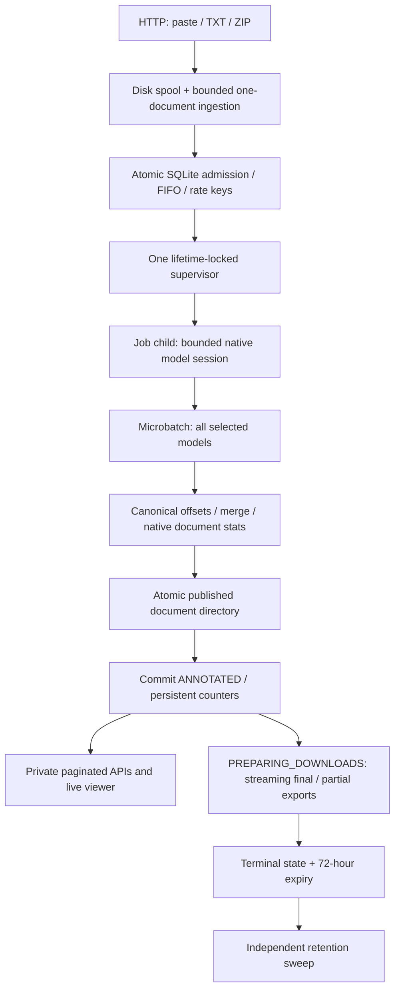

# Authenticated architecture with the V5 research interface

A default-deny session/CSRF gate precedes upload spooling. Central and service
owner guards protect every job locator/alias. Account/MFA/role/tier repositories
are separate from scientific inference. Atomic admission validates a live verified
owner and the actual whole-batch quota. History is owner-filtered; administration
has no clinical-owner bypass. See AUTHENTICATION_V4.md for the account architecture.

The composition root creates FastAPI, private local storage, SQLite repositories
and routers; it performs no NLP. HTTP routes validate transport contracts, job
use cases handle admission/access, the supervisor controls one child per job, and
the pipeline composes native ner_lab pieces over bounded document microbatches.

SQLite WAL is the actual queue, not Redis/RQ/PostgreSQL. BEGIN IMMEDIATE makes rate
checks, reservation transfer, job insertion and document-reference insertion
atomic across web processes. FIFO is acceptance sequence, not upload start time.
The existing worker claim/recover/finish boundary is the seam for a future queue
backend; multi-host processing requires an explicit database/queue migration.
Linux, one host and a private local filesystem are required; not NFS.

Job states: QUEUED → PROCESSING → COMPLETED / COMPLETED_WITH_ERRORS / FAILED →
EXPIRED → removed tombstone. Stages distinguish INFERENCE and PREPARING_DOWNLOADS.
Document states: PENDING → PROCESSING → ANNOTATED or FAILED. ANNOTATED means every
selected model and exact offset validation succeeded. Failed documents are never
counted as annotated. Counters derive from persistent rows, not a Python-only
counter or a guessed percentage. Source content is stored on disk, not in SQL.

Request bodies are byte-bounded and spooled to an anonymous private temporary
file. Multipart files are consumed as streams; ZIP validation yields at most one
bounded document at a time, preserving bytes and hierarchy. Upload leases are
persistent and bind their staging directories; long validation renews the lease.
Only exactly one input mode is accepted. Failed loads clean their private staging.

Storage admission uses persisted input/output bytes, configurable expansion
factor/additional reserve, queue/upload limits and actual free space. It performs
no completed-directory traversal in the admission transaction. Migration initially
reconciles old rows once. Expanded uploads grow reservations before writes. New
artifact/packaging writes have a conservative per-job budget. An encrypted local
volume with an OS quota is still required for a hard disk boundary; external
administrator writes and model files are outside job accounting.

The supervisor keeps heartbeats/cleanup alive while the child processes, enforces
a lifetime timeout and uses Linux parent-death signaling. Result transfer is an
atomic private JSON file, not an OS pipe. The native checkpoint cache is bounded,
job-scoped and released with the child. Interrupted jobs reuse only verified full
publications, preserving counts and model/tokenizer provenance.

Readers permit individual ANNOTATED documents while the job is running, preparing,
partially completed or failed with valid publications. Batch exports are available
only after packaging; partial attachment names/manifests distinguish failures.
Expired routes deny access immediately and cleanup removes the entire job root.
Pre-v3 tokens/deadlines remain unchanged by additive migrations.

The frontend remains local templates, CSS and ES modules. Shared progress/dialog/
countdown logic polls server state with backoff/visibility awareness and uses a
monotonic elapsed clock synchronized to server_now. It stores no clinical data in
browser persistence. Folder expansion, selection and filters survive live list
refreshes; the sweep-line renderer/Unicode mapping is preserved.

See INCREMENTAL_PROCESSING.md, MIGRATIONS_V3.md, VISUALIZATION_ARCHITECTURE.md and
PERFORMANCE_V3.md for data contracts, crash windows, viewer tradeoffs and measured
limits. CPU synthetic tests do not establish clinical/GPU/BSC capacity.

## Presentation composition

base.html/components.html share the institutional shell and local BSC asset.
ui.py supplies presentation context without replacing authentication dependencies.
ui_i18n.py and the auth vocabulary generate a deterministic browser dictionary;
explicit data-i18n marks presentation copy and leaves original text/model IDs alone.
Shared auth.js handles locale/navigation/dialogs, catalog.js serves both Models
and the request form, and progress.js/viewer.js preserve incremental reads/expiry.
Owner-scoped SQL aggregates and a limited history projection supply real dashboard
metrics/filename/language/model metadata. Session listing reveals no verifier;
deletions are institutional audit requests. DESIGN_SYSTEM.md documents component
and responsive boundaries; security and scientific services remain authoritative.
