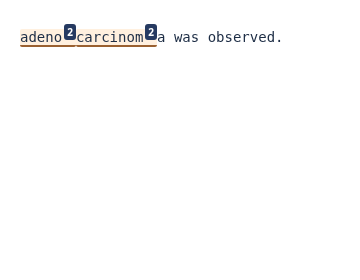
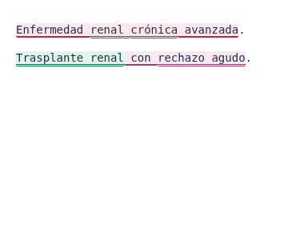
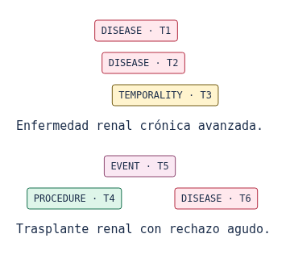
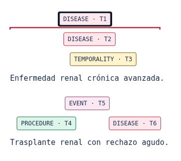
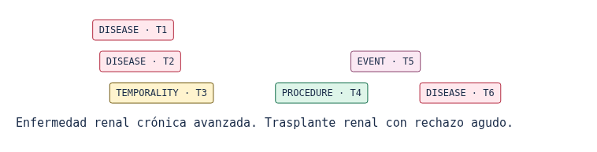
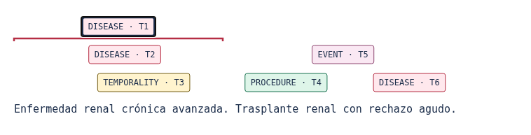

# Annotation reader review · 0.5.3

The reader offers inline highlights and BRAT-inspired entity towers over the same
original source and canonical annotations. Nested, crossing and equal-range
mentions remain distinct. Inference, consolidation and export rules are unchanged.

## Findings and corrections

### Reveal only the activated entity's marks (0.5.3)

All range marks are now invisible while labels retain their centered tower
positions. Clicking a label, or activating it with Enter/Space, reveals only that
annotation's marks, including wrapped fragments. Another activation hides them;
activating a different label switches the reveal. Hover/focus and prior inline
selection do not expose marks. The `aria-pressed` state indicates the toggle.
Resize/locale redraws preserve the active reveal; changing documents/modes or
filtering out the active annotation clears it. Label/source positions never shift
as marks are shown or hidden.

The previous gray fallback also made original model labels and unknown extensions
look uncolored. Display aliases now cover all54 original catalog labels and common
accented/BIO variants, with96 aliases in total. Canonical category colors stay
unchanged; new labels use24 stable, non-gray extension palettes. These are finite
palettes and may reuse colors. Scientific categories/labels/mappings are not
rewritten. The raw PROFESION display alias follows PROFESSION when no canonical
category is available; canonical ANONYMIZATION always retains its own color.

### Per-line centered towers (0.5.2)

The previous layout anchored labels to span starts and drew tall endpoint
connectors across lower lanes. It did not enforce shorter-below/longer-above
ordering. Towers now belong to independent source-line blocks. Labels are centered
over each visible entity range; shorter overlapping mentions are placed first,
closest to the text, and longer mentions above them. Equal lengths use a stable
position/ID order. The allocator reserves both label and range extents.

Every lane has a 26px label, its own short range caps and 40px spacing. No range
connector crosses another label or the source. Blocks reserve their full height
before drawing the next source line. Captions retain 12px glyphs without horizontal
compression or SVG scaling. Measured gutters retain exact centering at line edges;
horizontal scrolling exposes labels that extend beyond a narrow column.

Browser regressions now check centering against actual range geometry, all
shorter/longer overlap pairs, collisions between range marks and labels/source,
separation between complete line blocks, and font scale/readability before and
after resizing. Enter and Space selection and focus restoration remain covered.

### Earlier source/offset corrections (0.5.1)

The sweep renderer already emitted each source character once. The visible defect
was a CSS `::after` counter inserted at every multi-annotation segment: it could
make one word read like `adeno²carcinom²a`. These counters are removed. A double
underline and a summary outside the source identify overlapping annotations.
Selecting a region exposes every covering entity; tooltips include categories,
complete surfaces and exact ranges. Selecting/copying inline source preserves the
original text and whitespace.

The earlier illustrative scratch fixture ended `adenocarcinoma` at 13. That word
has 14 code points: its correct range is **[0,14)**. This was an example fixture
error, not evidence of a backend off-by-one defect. The permanent browser test
uses 14 and checks the last-character geometry. The interface explicitly states
that the end offset is exclusive.

Separating a base letter from its combining accent into styled DOM nodes could
move the accent. Both displays now preserve whole graphemes visually, while the
inspector, original annotations and exports retain exact model boundaries. Actual
overlap counts come from original ranges, before visual grapheme expansion.
Emoji sequences, combining marks, CRLF and non-Latin text are not normalized.

Towers show **one category/ID tag per annotation**, including multiword mentions
and mentions spanning wrapped lines. Continuations use brackets with the same ID.
Lane allocation considers both bracket and label width, preventing tag collisions.
Range marks stay in their own levels, with a clear gap above source text. Tags support
pointer, Enter and Space, retain focus after redraw, and expose complete surfaces,
offsets and provenance through the inspector/tooltips. They are 26px tall.
Resize, locale, filter and fragment changes redraw the same records. Page teardown
disconnects the observer so privacy clearing cannot trigger a stale redraw.
Folder controls also have a minimum 32px height, correcting a touch-target failure
exposed by the dense desktop tower accessibility scan.

This is a local, read-only span visualization, not the official BRAT editor. It
does not invent relation arcs or implement manual editing. BRAT TXT/ANN exports
still use the same validated original ranges.

## Canonical colors across languages

Color depends on canonical category, never UI/document language, checkpoint or a
hash bucket. All 13 current catalog categories have explicit colors; known aliases
share their canonical color. Unknown labels use24 stable extension palettes. This is a
consistent project convention, not a universal biomedical NER color standard.

| Category | Border / pale background |
|---|---|
| DISEASE | `#b52d43` / `#ffe8ed` |
| SYMPTOM | `#9b451c` / `#ffedde` |
| MEDICATION | `#2554a4` / `#e8efff` |
| PROCEDURE | `#16704e` / `#def5e9` |
| ANONYMIZATION | `#5b556e` / `#f0edf6` |
| EVENT | `#8c456f` / `#fae8f3` |
| HUMAN | `#805326` / `#faefde` |
| LOCATION | `#066b79` / `#dff4f8` |
| NEGATION_UNCERTAINTY | `#75429e` / `#f1e7fb` |
| PROFESSION | `#5b6424` / `#f1f4dc` |
| SITUATION | `#7c4750` / `#f8ecef` |
| SPECIES | `#32634e` / `#e6f2e8` |
| TEMPORALITY | `#735c14` / `#fff4ce` |

Labels, IDs, outlines, mention lists and the technical table supply redundant
cues; color alone is not used to identify a span.

The [static palette measurements](security/v5.3-entity-palette.json) record main
text, mention metadata and border contrast above4.5:1 for all37 active palettes.
These bounded CSS checks supplement browser scans, not conformance certification.

## Captures

These use controlled synthetic annotations, not clinical model predictions.
The earlier defect capture uses the incorrect scratch range disclosed above;
its purpose is to show CSS counters inside a word.

## Verification scope

`tests/test_overlap_readability.py` exercises four corpora at 320, 390 and 1440px:
inside-word boundaries, synthetic clinical multiword/nested spans, 18 dense
crossing/equal-range annotations and adversarial Unicode/CRLF. Tests compare every
code point's browser position with an unannotated control, check exact source
selection/reconstruction, visit every annotation by keyboard, and verify retained
focus, one tag per entity, no tag/tag or tag/source collisions, and bracket
endpoints against actual SVG glyph metrics. They also check line-layout roundtrips,
all catalog categories, color aliases and locale switching.

The complete suite additionally covers private accounts/ownership/sessions,
MFA/admin, publication, exports, original offset validation, retention, root/prefix
routing and native tiny-BERT CPU inference. Native tests use random tiny weights;
they do not establish biomedical model accuracy. Automated accessibility checks
do not establish WCAG certification. Extremely dense annotations can create tall
towers; the bounded reader scrolls and filters remain available. Long documents
retain the existing fragment API rather than being silently truncated.

The [72 axe-core scans](security/v5.3-axe.jsonl) report zero automatic WCAG-tagged
violations. Color contrast remains an incomplete rule in 44 scans, including
overlapping/SVG states; the separate static palette check does not resolve those
browser assessments. Human and assistive-technology review remains necessary.

Final executed results are in [VERIFICATION.md](VERIFICATION.md); rendering
contracts are in [OVERLAP_RENDERING.md](OVERLAP_RENDERING.md).
