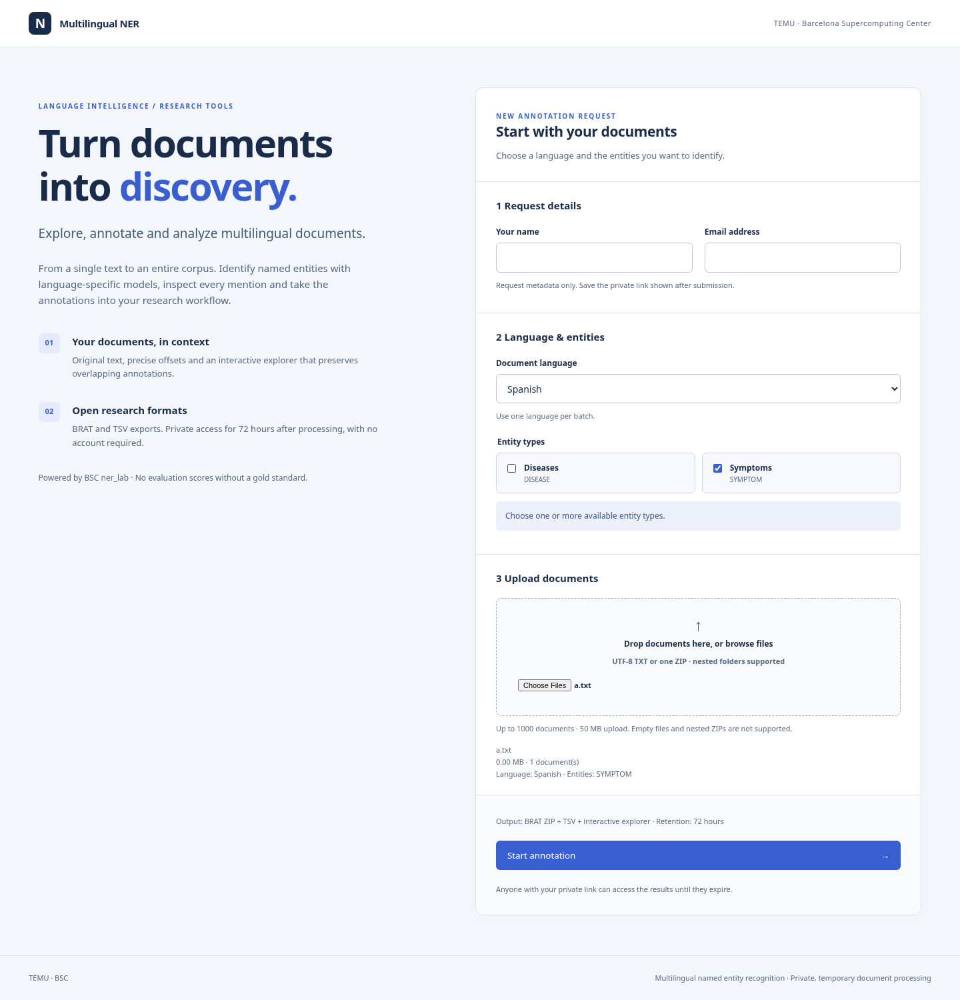
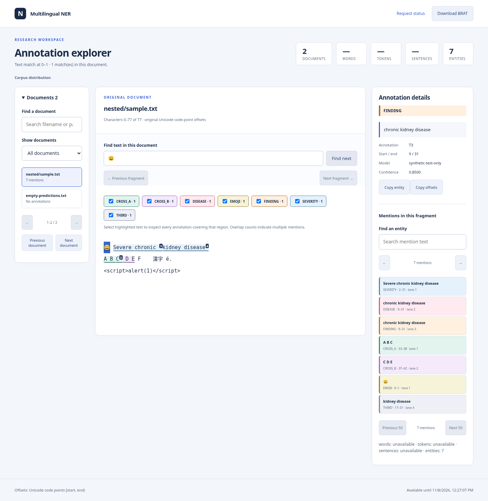
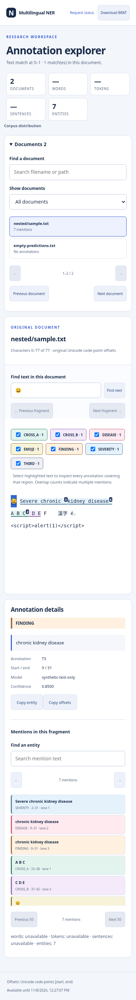

# Phase 2 visual checks

Captured by Chromium against the actual local application and prefixed document
APIs. These screenshots use a synthetic fixture with seven explicitly controlled
annotations, including nested, equal-boundary and crossing spans; they are not
clinical predictions. The form's catalog uses a test-only HTTP fixture. No such
model/catalog override is exposed in production.

## Home · 1440px

## Explorer · 1440px

## Explorer · 390px

Functional responsive tests additionally ran at 320, 375, 768, 1024, 1920 and
2560px. Every overlap was selected in both the document/list representations;
keyboard region selection exposed all four annotations in the densest region.
