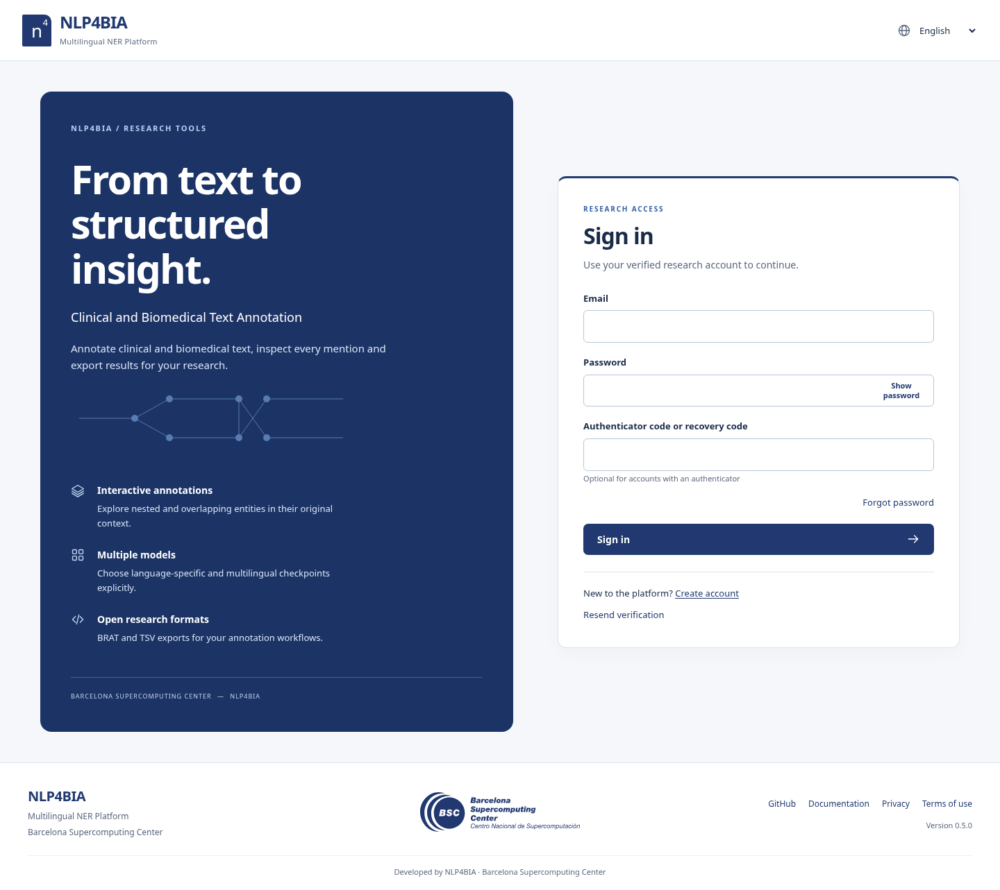
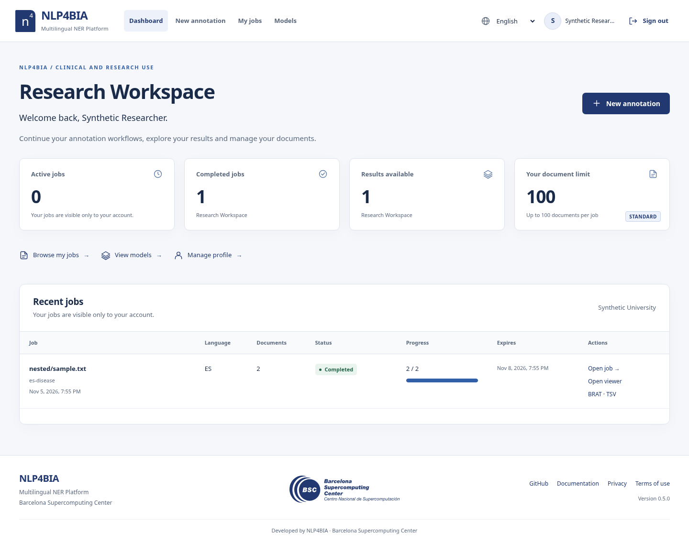

# V5: institutional redesign and release evidence

Release 0.5.0 builds on authenticated baseline 967e87d. The final full regression
completed with **188 passed in 305.86s**, zero failures/skips. The clean
HTTP-only environment separately ran **132 passed, 56 explicitly skipped in 41.24s**.

## 1. Redesign delivered

NLP4BIA · Multilingual NER Platform now has a shared institutional shell, public
research-access forms, private Research Workspace, My jobs, New annotation, Models,
Profile/security/session/deletion-request screens and MFA-protected administration.
Every work route still requires authentication. It remains FastAPI/Jinja/ES modules.

## 2. Design system

[DESIGN_SYSTEM.md](DESIGN_SYSTEM.md) documents tokens, typography, components,
entity colors, responsive layouts, local assets, native dialogs and translations.
The same header/footer is reused everywhere. System fonts, CSS and JS are local;
no production UI library, analytics or remote font dependency was added.

## 3. Actual captures

All screenshots below came from real Chromium visits. Accounts are synthetic and
were authenticated through the actual register/verify/login implementation. The
controlled predictor/overlap corpus is explicitly a test fixture, not a clinical
checkpoint or evidence of biomedical accuracy. Adversarial Unicode/XSS text in the
viewer capture verifies literal rendering; it is not executable page markup.
Captures contain no passwords, session cookies, email action tokens or MFA secrets.

| Screen | Desktop | Mobile |
|---|---|---|
| Login | [1440px](previews/v5/login-desktop.png) | [390px](previews/v5/login-mobile.png) |
| Registration | [1440px](previews/v5/register-desktop.png) | [390px](previews/v5/register-mobile.png) |
| Dashboard with jobs | [1440px](previews/v5/dashboard-desktop.png) | [390px](previews/v5/dashboard-mobile.png) |
| Empty dashboard | [1440px](previews/v5/dashboard-empty-desktop.png) | [390px](previews/v5/dashboard-empty-mobile.png) |
| New annotation | [1440px](previews/v5/annotation-desktop.png) | [390px](previews/v5/annotation-mobile.png) |
| Expanded catalog | [1440px](previews/v5/catalog-expanded-desktop.png) | [390px](previews/v5/catalog-expanded-mobile.png) |
| Annotation viewer | [1440px](previews/v5/viewer-desktop.png) | [390px](previews/v5/viewer-mobile.png) |
| Actual completion dialog | [1440px](previews/v5/completion-dialog-desktop.png) | Native mobile entity/confirmation dialogs exercised |
| Institutional footer | [1440px](previews/v5/footer-desktop.png) | [390px](previews/v5/footer-mobile.png) |
| Administration | [1440px](previews/v5/admin-desktop.png) | [390px](previews/v5/admin-mobile.png) |
| Administrative confirmation | [1440px](previews/v5/admin-confirmation-desktop.png) | [390px](previews/v5/admin-confirmation-mobile.png) |
| Profile | [1440px](previews/v5/profile-desktop.png) | [390px](previews/v5/profile-mobile.png) |
| Sessions | [1440px](previews/v5/sessions-desktop.png) | [390px](previews/v5/sessions-mobile.png) |
| Session expired | [1440px](previews/v5/session-expired-desktop.png) | [390px](previews/v5/session-expired-mobile.png) |
| My jobs | [1440px](previews/v5/jobs-desktop.png) | [390px](previews/v5/jobs-mobile.png) |
| Models | [1440px](previews/v5/models-desktop.png) | [390px](previews/v5/models-mobile.png) |
| Deletion request | [1440px](previews/v5/deletion-desktop.png) | [390px](previews/v5/deletion-mobile.png) |
| Verification | [1440px](previews/v5/verify-email-desktop.png) | [390px](previews/v5/verify-email-mobile.png) |
| Verification completed | [1440px](previews/v5/verification-complete-desktop.png) | [390px](previews/v5/verification-complete-mobile.png) |
| Recovery request | [1440px](previews/v5/forgot-password-desktop.png) | [390px](previews/v5/forgot-password-mobile.png) |
| Reset password | [1440px](previews/v5/reset-password-desktop.png) | [390px](previews/v5/reset-password-mobile.png) |
| Password updated | [1440px](previews/v5/password-updated-desktop.png) | [390px](previews/v5/password-updated-mobile.png) |





## 4. Login and registration

Research presentation, password reveal, clear labels/feedback, default quota note,
professional Other handling and EN/ES/CA remain integrated with actual server auth.
Long profession labels use a full-width field and a wrapping mobile caption. Extra
captures execute registration, single-use verification, forgot/reset and success
states at 390px and 1440px. No public testing verification API was added.

## 5. Workspace and profile

Metric cards use owner-filtered SQL aggregates over retained jobs, independent of
history pagination. Rows expose only the owner's filename/language/model/count/
state/progress/deadline/actions, with mobile cards and a real empty state. Profile
edits remain allowlisted. New session metadata excludes raw IDs/hashes/seeds/IPs.
Deletion requests are protected audit events for institutional handling, not an
immediate destructive operation. No new schema migration was required.

## 6. Viewer and annotation

Three-panel desktop/two-panel tablet/stacked phone layouts preserve the original
text, Unicode offsets, nested/crossing annotations, synchronized lists/tables,
provenance, text/category/model filters, keyboard mention navigation and individual
owned exports. Side panels/tables scroll within intentional bounds; reader lines
remain bounded on ultrawide screens. Progress percentages, completion dialogs and
72h countdown still use real persisted states and server time. Expired views clear
results/downloads; revoked sessions clear the page and show a translated notice.

## 7. BSC asset

The original supplied SVG is preserved byte-for-byte at
[app/static/assets/bsc-blue.svg](../app/static/assets/bsc-blue.svg). Its hash and XML
inspection are recorded in DESIGN_SYSTEM.md. Browser checks verify successful local
loading and the original aspect ratio, including footer/mobile/prefixed pages.
No imitation, recoloring, rasterization or external SVG reference was introduced.

## 8. Responsive and keyboard checks

The complete design matrix runs under both root and APP_PREFIX=/ner at:

| Width | Height |
|---|---|
| 320 | 640 |
| 375 | 812 |
| 390 | 844 |
| 768 | 1024 |
| 1024 | 768 |
| 1440 | 900 |
| 1920 | 1080 |
| 2560 | 1440 |

Actual pages exercise login, registration, populated/empty dashboard, jobs, models,
form/catalog, viewer, profile, sessions, deletion and admin/confirmations. The matrix
checks global overflow, horizontal control bounds, a single main title, logo ratio,
menu/Escape behavior, cancelled admin changes, model filters, overlap keyboard
activation, mobile dialogs, real completion and revocation notices. Technical
annotation tables have deliberate local scrolling with an equivalent mention list.

320px also covers reflow equivalent to400% on a1280px viewport, and768px covers200%-equivalent reflow on a1536px viewport. These are actual viewport/reflow tests,
not a claim of exhaustive browser-zoom or assistive-technology certification.

## 9. Translations

UI text is sourced once in Python and generated into the browser dictionary. Tests
check EN/ES/CA completeness/placeholder agreement and generated-source equality.
Actual browser language switching retains File objects, model IDs, input/document
language, original result text and model filters. Dates/numbers use Intl. Scientific
IDs/labels/provenance remain literal; future custom metadata requires translations.

## 10. Visual/accessibility results and corrections

Final matrix: 16 scenarios across two prefixes/eight viewports. Axe-core 4.14.0
executed **60 scans** at 390px/1440px with EN/ES/CA and **zero reported
WCAG-tagged violations**. [Redacted scan records](security/v5-axe.json) retain rule
names/targets, not HTML/input values. Axe still marks 32 scans with incomplete contrast checks on arrows/icons and
clipped technical-table columns; these are not silently counted as
proof of conformance. The palette and screenshots were reviewed separately.
Human screen-reader/zoom/usability assessment remains necessary.

Observed issues were corrected: missing group role for a named annotation region;
readability of non-selected text; indistinguishable in-paragraph links; long
profession truncation; compressed mobile name/email layout; oversized admin search
copy; always-expanded multilingual choices; and excessive inspector height. The
browser checks were repeated after corrections. A pre-existing cross-tab test race
was fixed by waiting for the already-started navigation. The countdown test retains
its server-skew assertion in the new compact display format.

## 11. Security and scientific regression

Before redesign, the 40 phase-one security/migration/browser cases passed in46.03s
(after correcting the test navigation race). The final188-case run repeats A–H:
real registration/email/session/hash/logout/reset, two-owner isolation and foreign
404, exhaustive anonymous denial, old token aliases, privilege/owner injection,
100/1000/UNLIMITED real quotas, CSRF/origins/MFA/revocation/suspension and /ner.
Old incremental/native tiny-BERT CPU/overlap/export/recovery/retention tests pass.

New tests additionally deny all new private pages/API anonymously, constrain
session output to four safe fields, reject deletion-owner injection/missing CSRF,
audit only the live requester and preserve ACTIVE state, and scope dashboard/history
by owner. [Current route matrix](ROUTE_SECURITY_V4.md) includes81 method/route pairs.
Only shared auth CSS/JS/vocabulary/logo are public; clinical/catalog APIs remain
private. No authentication-disable flag, fake production account or admin bypass
was introduced. The scientific offsets/consolidation/pipeline are unchanged.

Ruff lint/format, Jinja compilation, static formatting, Bandit medium/high and
pinned HTTP dependency auditing pass. Reports are versioned in security/. The
unchanged optional neural locks still carry the two disclosed upstream Torch
advisories; this redesign does not fix or conceal them.

## 12. Installation, packaging and deployment

Existing requirements and deployment remain compatible; no production dependency
was added. Configure HTTPS/public origin/prefix, Secure cookies and SMTP before
opening access. For a configured checkout:

```sh
pip install -r requirements.lock
python -m scripts.build_ui_translations
docker compose build web
docker compose up -d web worker
docker compose exec web python -m scripts.create_admin
```

Bootstrap uses an interactive terminal, new email, verification and MFA; no password
CLI argument or default administrator exists. See [README](../README.md),
[deployment](DEPLOYMENT.md), [authentication](AUTHENTICATION_V4.md) and
[recovery](RECOVERY_V4.md) for the complete secure configuration and neural profiles.

The 0.5.0 wheel/sdist and no-NLP Docker image build. Compose validates and web/worker
restart together. Root and isolated /ner containers check public login/brand/SVG,
minimal health/readiness, private API401 and HTML303; the prefix smoke completes
actual register -> captured mail -> confirmation -> login -> dashboard -> logout ->
401. Initial temporary startup hit disk exhaustion; removing this project's old
images/build cache fixed it without deleting volumes or unrelated containers.
Temporary fixtures are removed after checking; the production-default runtime
remains configured without SMTP and does not auto-verify users.

Three cold local Docker browser contexts measured a median load 220.8ms and zero
external resource requests. [Measurement](security/v5-ui-performance.json) is
unthrottled local evidence in the local environment, not a production benchmark,
performance-improvement comparison or capacity claim.

To reproduce browser/accessibility checks:

```sh
npm install --prefix work/design-a11y --no-audit --no-fund axe-core@4.14.0
AXE_CORE_PATH=work/design-a11y/node_modules/axe-core/axe.min.js \
AXE_REPORT=work/design-axe.jsonl SCREENSHOT_OUTPUT=work/design-screens \
BROWSER_TESTS=1 python -m pytest -q
```

Playwright/Chromium/test extras must be installed; CI installs these and gates the
same checks. These are locally executed results, not a claim that hosted Actions
has already completed.

## 13. Pending institutional/production work

Privacy and terms are explicit drafts needing institutional review, not invented
final legal notices. Real SMTP delivery, BSC TLS/HSTS/trusted-proxy integration,
key/backup/MFA-recovery operations, clinical checkpoints/GPU/full neural images,
external load and assistive-technology review remain outside local validation.
Resolve the upstream Torch advisories before describing neural production as
hardened. SQLite remains single-host. No security or WCAG certification is claimed.
