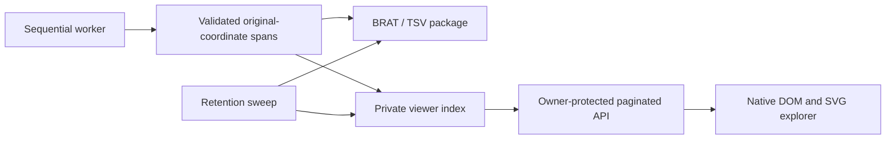

# Visualization architecture and reference review

Decision: a custom read-only viewer using native ES modules and safe DOM text
nodes. It shares original-document annotation contracts with exports, not BRAT
HTML/SVG or a second NER engine. An external BRAT integration could consume the
same canonical annotation JSON later, without changing inference or stored spans.

The requested Hugging Face DT4H demo URL and official brat.nlplab.org embed and
configuration pages were attempted but denied by this environment's HTTP policy
(403). No claim is made about the demo's inspected appearance, overlap behavior
or code. No policy bypass or third-party code copy was attempted.

The official nlplab/brat repository was accessible on GitHub and inspected at
44ecd825810167eed2a5d8ad875d832218e734e8. Its client/src visualizer and client/lib
show a dedicated SVG/client dependency stack; configurations/CRAFT/annotation.conf
and server/src/projectconfig.py document overlap policy. In particular the CRAFT
configuration explicitly explains that <OVL-TYPE>:<ANY> admits crossing overlaps.
Exports now declare `<OVERLAP> Arg1:<ANY>, Arg2:<ANY>, <OVL-TYPE>:<ANY>`.
No third-party viewer code or assets are redistributed, so no new frontend
license/dependency obligation is introduced.

A custom renderer was chosen for responsive wrapping, native keyboard/touch
interaction, small local dependencies, the existing application's CSP, and full
control over chunking/selection. BRAT remains an interoperable export target.
This is not an annotation editor: no label/offset changes or collaborative state.

A private index stores filename, stable document ID, mention counts, labels and
per-document statistics; each document has its own annotation JSON. IDs are
SHA-256-derived relative filename identities, scoped by the job capability token.
Input text is read from original UTF-8 bytes; Python code-point offsets remain
absolute. The index avoids loading text for 1,000 documents in list responses.

Default listing: 50 documents (maximum 100), filename/annotation-status/label
filters. Text defaults to 10,000 code points (maximum 50,000); the viewer uses
5,000-code-point fragments. Annotation responses default 200 (maximum 500) and
can filter overlaps with the current fragment, label and surface query. A span
crossing a fragment boundary retains its complete original start/end/surface.
Whole-document exact-text search returns the next match with absolute offsets
and wraps after the last match; the client loads its containing fragment.
The client pages through annotation responses for only the visible fragment;
mention-list DOM is paged at 50. Details and filters do not alter stored data.

Every API access validates the authenticated owner, document availability and
expiry before opening data. Historical capability links grant no access alone.
No browser persistent storage, remote requests, inline document HTML or public
cache is used. The open viewer clears private DOM content at its deadline and
refuses late responses after expiry. Document-change generations discard stale
loads. API expiry remains authoritative even if the browser clock is incorrect.

Server readers currently decode one full document (bounded by MAX_DOCUMENT_MB)
to produce a fragment and read that document's annotation file for filtering.
They do not memory-map multi-gigabyte corpora or implement a database span index.
Extremely dense annotations may require many JSON pages and a large active set;
benchmark real models before increasing corpus/document limits. Accessibility is
supported by labeled controls, focus states, text labels, keyboard-selectable
regions and an alternate mention list; no formal WCAG certification is claimed.

## Shared brackets above source text (0.10.5)

Each connected region of overlapping annotations has one bracket on a common
baseline immediately above the source glyphs. Disjoint and merely adjacent spans
retain separate brackets. Captions remain centered over their own entity and
stack only according to the existing minimum overlap depth. No bracket is drawn
under an individual caption, and there is no filled band above or behind text.

The existing interval sweep partitions each region at annotation boundaries.
The bracket is a single unfilled SVG path, with downward end caps. A hard-step
SVG gradient colors its stroke: one category color on singly covered portions,
alternating category colors on overlapping portions. Equal-category mentions
share their color. The gradient does not blend new colors or color uncovered gaps.
Artificial SVG spacing between captions uses the colors of the enclosing spans.
Gradient repetition is bounded to avoid unnecessary SVG nodes for long spans.

Wrapped continuations get a shared bracket on each source line and keep one
caption per annotation. Bracket endpoints follow measured source glyphs and
respect graphemes; the scientific offsets and exported text are unchanged.
Space above the actual glyph box keeps brackets clear of accents and emoji.
Selecting a caption opens its inspector and emphasizes that caption; shared
brackets remain visible. Captions and shared brackets use the same canonical category color, consistent
across interface/document languages. Version 0.10.6 preserves the user's reference
families: DISEASE light pink, SYMPTOM orange, PROCEDURE blue and MEDICATION green.
Caption text is dark on light fills and white on dark fills (at least 4.5:1
contrast). Inline fills remain pale variants of the same color family. All current
colors and measurements are listed in OVERLAP_REVIEW.md.

## V3 live publications

New jobs use SQLite document metadata and immutable per-document publications,
not a final-job index prerequisite. PENDING/PROCESSING/FAILED leaves are disabled;
ANNOTATED documents open immediately. A paginated folder tree retains expansion,
filters, scroll and selected document when polling adds results. Model version and
overlap peers appear in the inspector; the synchronized paged table is an alternate
selection route. A mobile native dialog provides a bottom-sheet detail action.

The job/viewport share one progress controller with backoff, visibility/focus
reconnection and a collapsible persistent bar. Provisional native counts cover
annotated documents only. Exact server-clock expiry clears private content,
including table rows and individual links. TXT/ANN downloads are individually
available; batch downloads wait for explicit final/partial packaging. The previous
v2 final-index/backfill path remains for valid old jobs.

## V5.1 overlap reader

`spans.js` owns exact sweep segments, grapheme-preserving display segments and the
shared canonical color map. `viewer.js` draws the inline DOM and selection/details.
`towers.js` wraps the same original fragment, allocates lanes from actual interval overlap (caption width only adds horizontal spacing) and draws
one SVG tag per annotation with continuation brackets. All three modules are local
and use safe text nodes, never document HTML. They consume the existing private
annotation APIs and introduce no schema, inference or export changes. Expiry and
account revocation clear both source views. Details: [OVERLAP_RENDERING.md](OVERLAP_RENDERING.md).
